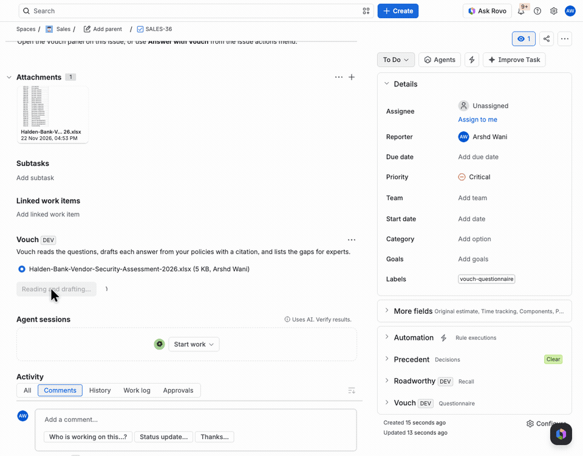
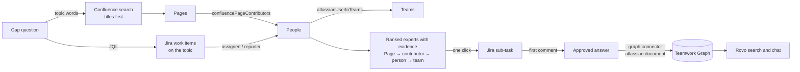

# Vouch

**Vendor security questionnaires, answered where the work already is.**



Sales, solutions and security teams lose days on SIG/CAIQ-style spreadsheets:
- In Whistic's 2023 survey, [54% of companies respond to at least 11 security questionnaires a month, and 9% to
  50 or more](https://www.whistic.com/resources/blog/state-of-vendor-security-report-challenges-and-solutions).
- In the same survey, [more than half spend at least 20 hours a week on vendor
  assessments](https://www.whistic.com/resources/blog/state-of-vendor-security-report-key-takeaways).
- Some organisations [receive close to 1,000 questionnaires a year](https://upguard.com/blog/security-questionnaire-burden).

These are vendor-published surveys, so read them as directional.

The answers usually already exist in your Confluence policies, and the people who know the rest are already in
your Teamwork Graph. With Vouch you attach the customer's spreadsheet to a Jira issue and click **Answer with Vouch**:

1. **Reads the questionnaire** (XLSX or CSV) and finds the question column and where answers go: a Yes/No
   column, a comments column, or a new one. It handles merged two-row headers.
2. **Drafts every answer from your own Confluence policies and approved answer library**, with a citation and a
   confidence (high, check this, none). A security thesaurus maps customer wording to policy wording
   ("logically segregated", "multi-tenant" → tenant isolation; "Okta", "IdP" → SSO; "break into" → pen test).
3. **Writes the reply with Forge LLM** when the site has it ("Yes. We encrypt all customer data at rest with
   AES-256 [1]."). This step is grounded and checked: every claim cites a numbered passage. A reply that cites
   nothing, cites a passage it wasn't given, or states a number the sources don't contain is discarded for the
   verbatim extract. The LLM can rewrite or veto an answer (NO_ANSWER), never invent one.
4. **Routes the gaps to the right person through the Teamwork Graph.**
   - Vouch searches Confluence for the topic, titles first, and asks the graph who contributed to those pages
     (`confluencePageContributors`) and which teams they're in (`atlassianUserInTeams`).
   - You see the top three candidates with evidence, for example "Contributed to 4 of 4 pages about onboarding
     in Employee Onboarding".
   - One click creates a Jira sub-task for the expert, carrying the question, why they were picked and the nearest
     passages.
5. **The expert's first comment becomes the answer.** It flows into the questionnaire and the library, and the
   sub-task closes.
6. **Export** attaches the original spreadsheet back to the issue with the answers filled in. Styles stay, formulas
   are untouched, and citation markers are removed.
7. **Approved answers go back into the Teamwork Graph.** A `graph:connector` writes them as `atlassian:document`
   objects, so Rovo and search can find them.

Also included:
- A Rovo agent "Vouch" with three actions: answer a question with sources, questionnaire status, and route a
  question to an expert. A Rovo skill, `answer-security-question`.
- An issue badge ("35/40 answered · 2 with experts").
- An answer library.
- An "Answer quality check" for admins.
- One-click sample data with Remove.
- Runs on Atlassian, with no external egress.

## Teamwork Graph: read and write



- **Read.** Who should answer a gap is decided by the graph, not by a settings list. Vouch finds pages on the topic,
  their contributors (`confluencePageContributors`) and those people's teams (`atlassianUserInTeams`). It adds
  people working Jira issues on the topic. The expert modal and the sub-task show the chain, for example "Page Mac
  VPN Setup → contributor → Ada Isadora".
- **Write.** Approved answers become `atlassian:document` objects through the app's own `graph:connector`, so the
  organisation's answers become searchable knowledge, not rows in an app.

**Fresh or quiet site.** Suggestions come from real work, so on a new site the graph may have nobody to suggest.
Vouch then says so plainly, offers **Send to someone else** (any user, including yourself), and still creates the
sub-task. On a one-person site you are offered as the expert.

## How Vouch compares
These comparisons are based on the vendors' public product descriptions at the time of writing; they are not hands-on tests.

| | Vouch | Loopio | Vanta (questionnaire automation) | SafeBase |
|---|---|---|---|---|
| Where the work happens | Inside Jira, Confluence and Rovo | Separate RFP and response app | Separate compliance platform | Trust center and questionnaire assistant |
| Knowledge source | Your Confluence policies plus an approved library, read with the user's permissions | Its own content library | Its own controls and documents | Its own trust content |
| Who answers the gaps | Picked through the Teamwork Graph from real work, with evidence; Jira sub-task | Assigned in-app | Assigned in-app | Assigned in-app |
| AI drafting | Every claim cites a passage; uncited answers and invented numbers are rejected; the LLM can veto, never invent | AI-assisted (see vendor docs) | AI-assisted (see vendor docs) | AI-assisted (see vendor docs) |
| Data egress | None (Runs on Atlassian) | Vendor cloud | Vendor cloud | Vendor cloud |
| Approved answers in Rovo search | Built in (`graph:connector`) | Not built in | Not built in | Not built in |

Vouch is not a full trust center or GRC suite. It is the questionnaire workflow for teams that already live in
Atlassian.

## Requirements
- Jira and Confluence Cloud on the same site. Vouch installs in Jira and needs Confluence for the policy pages.
- **Rovo**, for the agent, the skill and search over approved answers.
- **Teamwork Graph**, for expert routing. Without it, Vouch falls back to page creators and editors.
- **Forge LLM** is optional. Without it Vouch uses verbatim extracts, which are deterministic and unit-tested.

## Try it in 2 minutes (judges)
1. Jira → **Apps → Vouch** → **Getting started** → *Try it with sample data*.
   - Choose a Confluence space for the 10 sample policy pages, and a Jira project (Jira admins only).
   - Click **Load sample**.
2. Open the created issue ("Halden Bank vendor security assessment"). Open the **Vouch** panel (the apps button
   under the title) and click **Answer with Vouch**. Forty questions are drafted, with a progress bar.
3. Click **Approve N high-confidence**, then **Review** any "Check this" row to see the cited passages and the
   source text.
4. Filter to **Gaps**, then click **Find expert** on GAP-02 (VPN), GAP-03 (onboarding) or GAP-01 (insurance).
   - On our demo site each goes to a different person, with the evidence chain.
   - On your site the people depend on your own pages and issues. If nobody else has worked on a topic, Vouch
     says so; use **Send to someone else** (yourself works).
   - Click **Send to…** or **Create sub-task**.
5. Comment on the sub-task as the expert ("Yes. We use …"). The row turns "Expert answer" within seconds.
6. Click **Export XLSX**. The filled spreadsheet is attached to the issue.
7. **Ask Rovo** → agent **Vouch**:
   - "What's our answer on data retention?"
   - "Status of the <issue> questionnaire"
   - "Route question 39 to an expert"
8. **Settings → Answer quality check** runs 80 questions against your spaces and counts wrong answers.

## Connect the answer library to the Teamwork Graph (admin)
admin.atlassian.com → **Connectors** → **Add connector** → **Vouch answer library** (under *Other*) → Connect.

After you connect:
- Vouch pushes the existing library, then every newly approved answer.
- The Library tab shows the sync state per answer and has **Sync all to Teamwork Graph**.

## How it works
| Piece | Where |
|---|---|
| ZIP reader and writer (zlib inflate/deflate, CRC32), XLSX read, fill-in and build, CSV | `app/src/core/zip.js`, `xlsx.js`, `csv.js` |
| Questionnaire layout detection (header row, question, Yes/No and comment columns, sections) | `app/src/core/questionnaire.js` |
| Thesaurus, stemming, Confluence storage format → text | `app/src/core/text.js` |
| Heading-aware chunks and BM25 retrieval; per-question CQL for spaces over 300 pages | `app/src/core/retrieval.js`, `app/src/service.js` |
| Grounded extract, confidence, library matching | `app/src/core/draft.js` |
| LLM prompt, reply validation and merge rules | `app/src/core/grounded.js`, `app/src/llm.js` |
| Expert ranking (title-weighted pages, contributors, teams) | `app/src/core/experts.js`, `app/src/twg.js` |
| Teamwork Graph connector | `app/src/graph.js` |
| Answer benchmark and its question sets with answer keys | `app/src/core/benchmark.js`, `app/src/core/sample.js` |

Other implementation details:
- **Drafting runs in resumable steps** under the 25-second resolver limit. A live run drafted a 200-question
  workbook with Forge LLM in 57 s.
- **Questionnaire rows are stored in 25-row parts**, because one KVS value holds at most 240 KB.
- **Data stays on Atlassian.** Vouch stores questionnaires, settings and the library in Forge storage. Confluence
  pages are read with the viewing user's permissions.

## Quality (built-in answer check, live on the dev site)
| Question set | Correct | Wrong |
|---|---|---|
| Sample questionnaire (40) | 40/40 | 0 |
| Same questions in customer wording (40) | 40/40 | 0 |

- The verbatim extract and the Forge LLM writer score the same on both sets.
- A wrong answer means a confident answer from the wrong page, or any answer to a question that has no policy.
- Before the thesaurus, the customer-wording set scored 19/40, with 2 wrong.
- On 12 held-out questions never used for tuning: 8/12 correct and 0 wrong. The other 4 go to experts.

## Development
```sh
cd app
npm install
npm test                        # 58 tests: core units plus end-to-end flows with Forge mocked in memory
../bin/forge deploy --non-interactive -e development
```
